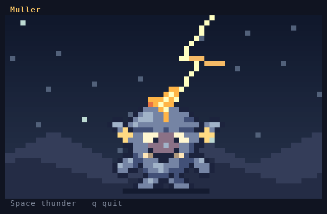

# Dunder Agent

En terminalagent för kodarbete, skriven i Dunder med dunder-tui. Ge den en uppgift i ett repo. Den kan söka och läsa kod, göra riktade ändringar, skapa filer, köra lokala kontroller och fortsätta utifrån resultatet.

## Kör

Bygg med Dunder 0.12.1. Du behöver ripgrep för sökning och OpenCode 2.3.2 med en konfigurerad modell. Första bygget hämtar låsta Git-beroenden. Följande kommandon utgår från repots rot.

```sh
dunder build --locked -o build/dunder-agent
install -d "$HOME/.local/bin"
install -m 755 build/dunder-agent "$HOME/.local/bin/dunder-agent"
dunder-agent
```

Åsktrollet **Muller** möter dig på startskärmen och visar när modellen tänker, kör ett kommando eller väntar på ett godkännande. Kör `dunder-agent mascot` för att se honom i sitt oväder. Mellanslag kallar ned blixten och q eller Esc avslutar.



Enter skickar en uppgift. Piltangenterna rullar historiken. Esc avbryter ett pågående modell- eller kommandoanrop. När agenten är ledig avslutar Esc terminalen. Ett skalkommando som modellen föreslår visas före körning och kräver ett tryck på y. Tryck n för att neka.

Kör kommandona från projektets rot. Med `--workspace DIR` kan du välja en annan arbetskatalog.

```sh
dunder-agent --workspace . --check 'dunder test' run 'Fixa det röda testet'
dunder-agent --workspace . --sessions
dunder-agent --workspace . --resume SESSION_ID --check 'dunder test'
```

I en terminal visar `run` Mullers arbetsstatus på stderr. När utdata omdirigeras går bara slutsvaret till stdout. Använd `--plain` för att stänga av animationen även i en terminal.

Vid turens början får agenten rotens filnamn och instruktionerna i `AGENTS.md`. Den kan läsa upp till åtta relaterade filer i ett modellsteg och köra den angivna kontrollen direkt efter sista redigeringen. Filverktygen använder relativa sökvägar och avvisar symboliska länkar. En redigering kräver en unik träff på den gamla texten. Skrivning publiceras atomärt. Skal och verifieringskommandon körs med användarens vanliga rättigheter i arbetskatalogen.

`--check` gäller den aktuella körningen. Har agenten ändrat en fil körs kontrollen före slutsvaret även om modellen glömmer att begära den. Om körningen avbryts efter en skrivning använder nästa tur den sparade historiken för att fånga upp kontrollen. Batchläget ger felkod för bland annat röd slutkontroll, modellfel, blockerat uppdrag och uppnådd stegbudget. Standardgränsen är 24 modellbeslut per tur och kan ändras med `--max-steps`.

## Modell och historik

Dunder äger kontexten, verktygsanropen, avbrotten och historiken. Varje beslut hämtas från OpenCodes lokala `/api/experimental/generate/text` med Dunders HTTP-klient. Standardmodellen är `zai-coding-plan/glm-5.4`. OpenCode använder sin befintliga GLM-inloggning. `--model provider/modell` väljer en annan modell som redan finns i OpenCode. Integrationen är provad mot OpenCode 2.3.2 på IPv4-loopback. [OpenCodes API-kontrakt](https://github.com/anomalyco/opencode/blob/v2.3.2/packages/protocol/src/groups/generate.ts) · [GLM Coding Plan](https://docs.z.ai/devpack/tool/others)

Sessionerna sparas efter varje händelse under `$XDG_STATE_HOME/dunder-agent`, normalt `~/.local/state/dunder-agent`. De innehåller instruktioner, verktygsresultat och svar och har filrättighet 0600. En session hör till en arbetskatalog och kan öppnas för skrivning av en process åt gången.

## Mål

Dunder Agent ska lösa fler verkliga koduppgifter än **minst tre av fem** open source-harnessar. Den låsta abonnemangsserien jämför OpenCode, Pi, Goose, Cline och Kilo Code med samma GLM-modell, startrevision, uppgift och tidsbudget. Aider reserveras för en separat körning med lämplig modellåtkomst. Kör tre gånger per uppgift på minst tolv uppgifter som omfattar felsökning, flerfilsändringar, teståterkoppling och återupptagning. Räkna en uppgift som löst när en oberoende kontroll passerar i minst två körningar. Redovisa också mediantid och antal manuella ingrepp per harness.

Tolv uppgifter har verifierade startlägen och referenslösningar. De första pilotkörningarna är gjorda. Den fullständiga serien omfattar 216 försök. [Uppgifter, metod och pilotresultat](dogfood/README.md)

## Lokal verifiering

```sh
dunder test --offline --locked
dunder run tests/acceptance.ddr --offline --locked -- build/dunder-agent
dunder run dogfood/run.ddr --offline --locked -- build/dunder-agent
```

Acceptansprovet använder en lokal modellfixtur. Dogfoodprovet använder ditt riktiga GLM-abonnemang. CI och pull requests är förbjudna. Utveckling och verifiering sker lokalt och verifierade ändringar committas direkt på main.
